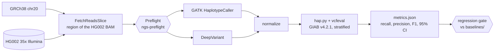

# wgs-release-validation

A germline whole-genome analysis workflow is validated for release by calling variants in a
region of GIAB HG002. Calls are evaluated against the GIAB truth set by genomic stratum, and all
tool or parameter changes which worsen results are blocked.

[](https://github.com/ericwootton/wgs-release-validation/actions/workflows/ci.yml)
[](LICENSE)
[](wdl/main.wdl)

Documentation, results, case studies, and runbooks: **<https://ericwootton.github.io/wgs-release-validation/>**

https://github.com/user-attachments/assets/8d06912b-63b6-4546-9d6f-29694b36c11f

## Results at a glance

<!-- results:start -->
HG002 results were evaluated against GIAB v4.2.1 over 5 Mb on chr20 (`full` profile, mean depth
36.3x). F1 is shown with missed and false calls in brackets. Full tables with confidence
intervals are available in [`docs/results/full/metrics.md`](docs/results/full/metrics.md).

| Type | Stratum | Truth variants | GATK 4.7.0.0 | DeepVariant 1.10.0 |
|---|---|---:|---:|---:|
| SNP | all benchmark regions | 6,298 | 97.92% (82 FN, 182 FP) | 99.31% (68 FN, 19 FP) |
| SNP | not_difficult | 4,767 | 99.90% (0 FN, 10 FP) | 100.00% (0 FN, 0 FP) |
| SNP | all_difficult | 1,531 | 91.94% (82 FN, 172 FP) | 97.11% (68 FN, 19 FP) |
| SNP | lowmap_or_segdup | 1,063 | 88.69% (79 FN, 172 FP) | 95.91% (67 FN, 18 FP) |
| INDEL | all benchmark regions | 816 | 97.87% (14 FN, 20 FP) | 99.44% (8 FN, 1 FP) |
| INDEL | not_difficult | 254 | 100.00% (0 FN, 0 FP) | 100.00% (0 FN, 0 FP) |
| INDEL | all_difficult | 564 | 96.89% (14 FN, 20 FP) | 99.19% (8 FN, 1 FP) |
| INDEL | lowmap_or_segdup | 82 | 85.98% (7 FN, 17 FP) | 95.57% (6 FN, 1 FP) |

Both variant callers showed nearly perfect performance outside regions which were difficult
to analyze. Differences were found in repetitive and duplicated sequence regions, where most
SNP false calls produced by GATK were located.
<!-- results:end -->


The comparison with the GIAB v5.0q draft benchmark, costs for each variant caller,
and recommendations are provided in
[the caller comparison](docs/results/caller-comparison.md).

## Why this exists

Even a workflow which produced correct results last month may produce different results after an
image update or a change in defaults. Nobody notices these changes until a customer detects
them. This repository shows how a fixed benchmark, thresholds for each stratum, gates in CI,
and documented decisions for each upgrade can be used to detect these changes before release.

## Quickstart

Linux or macOS, Docker, and Python 3.10+ are required. Images require about 12 GB of disk space
when using GATK (the GATK image itself requires 9 GB, and adding DeepVariant requires an
additional 7 GB). Downloaded GIAB files require less than 1 GB of disk space.

```bash
python3 -m pip install -r requirements-dev.txt     # miniwdl, PyYAML, matplotlib, pytest, ruff, mypy
docker build -t happy-vcfeval:0.3.15-rtg3.13 docker/happy-vcfeval
make run PROFILE=fixture                           # committed test data, no GIAB downloads (minutes)
make ci                                            # 200 kb of chr20, then the regression gate
```

`make ci` downloads the GIAB files once, verifies them against MD5s, and streams the required
sequencing reads over HTTPS. If performance in any gated stratum declines beyond the tolerance in
`baselines/ci.json`, it exits with a nonzero exit code. Input checks require the
[ngs-preflight](https://github.com/ericwootton/ngs-preflight) image
(`docker build -t ngs-preflight:0.1.0 <path to ngs-preflight>`). Without it, add
`EXTRA="run_preflight=false"`.

## What it does



Every task records wall time, CPU time, and peak memory. These feed the
[cost estimate](docs/results/cost-estimate.md). See
[How it works](docs/workflow.md) for details.

What else is here:

- **Upgrade reports**: [GATK 4.6.2.0 → 4.7.0.0](docs/upgrade-reports/2026-10-23-gatk-4.6.2.0-to-4.7.0.0.md),
  [DeepVariant 1.9.0 → 1.10.0](docs/upgrade-reports/2026-10-23-deepvariant-1.9.0-to-1.10.0.md).
- **An incident the gate caught**: [INC-01](docs/incidents/INC-01-mapq-default-change.md), a proposed
  change to the MAPQ default rejected before release.
- **Support ticket case studies** (each case ends with a reply to the customer).
  [CS-01](docs/case-studies/CS-01-missed-variants-lowmap.md) covers missed variants
  in low mappability sequences, and
  [CS-02](docs/case-studies/CS-02-contig-names.md) compares `20` and `chr20`.
  [CS-03](docs/case-studies/CS-03-deepvariant-memory.md) covers DeepVariant running
  out of memory, and [CS-04](docs/case-studies/CS-04-partner-handoff.md) covers the
  hand-off to a long-read partner.
- **Runbooks** for [release validation](docs/runbooks/release-validation.md),
  [failed-run triage](docs/runbooks/failed-run-triage.md), and
  [updating baselines](docs/runbooks/updating-baselines.md), along with an
  [FAQ](docs/kb/faq.md).
- **Optional modules**: long-read SV, tandem repeat and methylation QC with a partner hand-off
  folder (`wdl/optional/longread.wdl`), and customer deliverables (`wdl/optional/deliverables.wdl`,
  [what the customer receives](docs/deliverables.md)).
- **SV merging study**: [Six ways to combine pbsv and Sniffles calls](docs/results/sv-merging.md),
  each benchmarked against GIAB v5.0q (`wdl/optional/sv_merge.wdl`).
- **Cloud**: [steps for AWS HealthOmics and GCP Batch](docs/results/cloud-run.md) (written, not yet run).
- **GA4GH**: the same workflow was [run through a WES API](docs/ga4gh.md) on Cromwell (results
  were the same as miniwdl). `.dockstore.yml` was provided for Dockstore (TRS), along with
  notes on DRS inputs.
- **[Validation summary](docs/validation-summary.md)**: Accuracy, repeatability, and reportable
  range organized in the format used in a laboratory validation summary (not clinical validation).

### Tools

| Tool | Version | Image |
|---|---|---|
| GATK HaplotypeCaller | 4.7.0.0 | `broadinstitute/gatk:4.7.0.0@sha256:7da5cf58…` |
| DeepVariant | 1.10.0 | `google/deepvariant:1.10.0@sha256:962e5a83…` |
| hap.py with RTG vcfeval | 0.3.15 / RTG 3.13 | built from `docker/happy-vcfeval` |
| samtools / bcftools | 1.24 | biocontainers, pinned by digest |
| mosdepth | 0.3.14 | biocontainers, pinned by digest |
| ngs-preflight | 0.1.0 | built from the companion repo |

Full digests are provided in `wdl/main.wdl` and recorded in `metrics.json` for every run.

## Data and citations

| Data | Source |
|---|---|
| Reads | HG002 NovaSeq PCR-free 35x, GRCh38 no-alt (Google DeepVariant case-study data) |
| Reference | `GCA_000001405.15_GRCh38_no_alt_analysis_set` |
| Truth | GIAB HG002 v4.2.1 (gate); GIAB v5.0q small variants (**draft**, comparison only) |
| Strata | GIAB genome stratifications v3.6 |

URLs and MD5s are in `config/data_manifest.tsv`. GIAB data are released by NIST for benchmarking.

- Zook JM et al. *Sci Data* 3, 160025 (2016). [doi:10.1038/sdata.2016.25](https://doi.org/10.1038/sdata.2016.25)
- Wagner J et al. *Cell Genomics* 2(5), 100128 (2022). [doi:10.1016/j.xgen.2022.100128](https://doi.org/10.1016/j.xgen.2022.100128)
- Dwarshuis N et al. *Nat Commun* 15, 9029 (2024). [doi:10.1038/s41467-024-53260-y](https://doi.org/10.1038/s41467-024-53260-y)
- Krusche P et al. *Nat Biotechnol* 37, 555–560 (2019). [doi:10.1038/s41587-019-0054-x](https://doi.org/10.1038/s41587-019-0054-x)

## Limitations

- 1 sample (HG002), 1 chromosome, and a maximum of 5 Mb. Accuracy within a 5 Mb
  region on chr20 does not represent whole-genome accuracy. Furthermore, confidence
  intervals for small strata are relatively wide (reported in all tables).
- Benchmark evaluation is limited to GIAB confident regions. Some of the most difficult
  sequences to analyze lie outside these regions. The draft v5.0q benchmark includes more of
  them, which is why scores against v5.0q are lower.
- The gated workflow uses only short-read data. The long-read module is used for hand-off QC and is not included in the regression gate.
- For research use only. Nothing here is validated for use in clinical decision-making.
- The cloud run is documented but has not been executed. The cost model is therefore an
  estimate based on local resource usage and public prices.

### Gotchas found on the way

- **The read header has to be trimmed by re-encoding, not `samtools reheader`.** Because BAM
  records reference contigs by index, using `reheader` to remove `@SQ` lines moves reads to the
  wrong chromosome silently. `FetchReadsSlice` instead re-encodes the reads through SAM text.
- Contrary to a common assumption, **GATK 4.7 and DeepVariant 1.10 work when the BAM header
  contains additional contigs**. In fact, a name mismatch silently breaks a run (`20` versus
  `chr20`) ([CS-02](docs/case-studies/CS-02-contig-names.md)).
- **Some images cannot stream over HTTPS.** Since `staphb/samtools:1.24` has no CA
  certificates, htslib fails with libcurl error 60. The biocontainers images run correctly.
- **hap.py from bioconda cannot use vcfeval**: it is built without vcfeval and does not ship
  RTG Tools. `docker/happy-vcfeval` adds RTG Tools 3.13.
- **DeepVariant can hang instead of failing when out of memory**: When a worker is forcibly
  terminated due to OOM, other workers wait about five minutes and then exit with code 247 with
  no message. Near the limit, this occurs in some runs and not in others. The task now monitors
  the container's OOM counter and produces a message which explicitly identifies memory as the
  cause when it fails ([CS-03](docs/case-studies/CS-03-deepvariant-memory.md)).
- **Cromwell 92 cannot run digest-pinned images on the local backend**
  ([cromwell#7846](https://github.com/broadinstitute/cromwell/issues/7846)). However, Cromwell 91
  runs the workflow as written ([GA4GH standards](docs/ga4gh.md)).
- **Task images should run as root.** Cromwell stored downloaded inputs so that only its own
  runtime user had read access. Therefore, the ngs-preflight image running as an unprivileged
  user failed in Cromwell while it ran successfully in miniwdl.
- **`truvari refine` can hang with its default POA aligner**: In one 40 kb region, the 32 GiB
  memory allocation failed, and CPU usage remained at 0% during the subsequent wait. The
  long-read module was switched to MAFFT with a timeout of 30 minutes
  ([CS-04](docs/case-studies/CS-04-partner-handoff.md)).

## Repository layout

```text
wdl/main.wdl, wdl/tasks/   the workflow; wdl/optional/ has the long-read and deliverables modules
scripts/                   data preparation, metrics, regression gate, plots, cost model, cloud inputs
config/                    data manifest (URLs, MD5s), profiles, gate thresholds, cloud prices
baselines/                 gated reference metrics (change only per the baseline runbook)
inputs/                    inputs JSON per profile and module
docs/                      the documentation site; docs/results/ holds committed run outputs
docker/happy-vcfeval/      hap.py with RTG vcfeval
cloud/                     example Cromwell config and image helper for a cloud run
tests/                     offline unit tests and the fixture data
CLAUDE.md                  conventions for working on this repository
```

## How this was built

The author made the design decisions about what to benchmark and how, regression gate rules and
thresholds, and how each case study was written. The author also reviewed the changes and verified
the results. Following these instructions, [Claude Code](https://claude.com/claude-code) did
scaffolding, generated tests, and made iterative changes. These changes also underwent independent
AI review. All numerical values in the documentation came from files generated by actual workflow
runs using public data. See [`CLAUDE.md`](CLAUDE.md).

## Licence

MIT, see [`LICENSE`](LICENSE). GIAB data are public. See the citations above.
