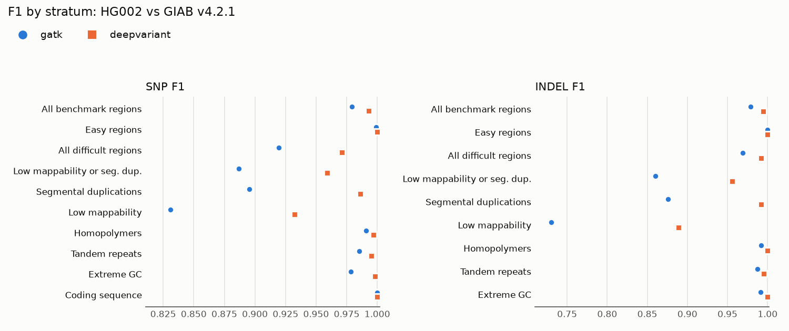

# Caller comparison: GATK HaplotypeCaller or DeepVariant?

**Recommendation: make DeepVariant 1.10.0 the default for short-read germline WGS, and keep GATK
4.7.0.0 for customers who need GATK's GVCF and joint-genotyping path or must stay consistent with
data already processed by GATK.** Using the same reads, DeepVariant was at least as accurate in
every stratum of the benchmark used for the regression gate. This was also observed in all but 1
stratum of the draft benchmark. SNPs in homopolymers were the exception (226 variants, F1 of
98.20% for DeepVariant against 98.43% for GATK). DeepVariant produced one tenth as many SNP false
calls, and running costs were nearly identical.

All results below were obtained for a single sample (HG002, 35x NovaSeq) in a 5 Mb region on
chr20 (`full` profile). Runs were performed on the same machine using the same inputs. This is
sufficient to see a consistent pattern, but not to quote genome-wide accuracy.

## Accuracy against the GIAB v4.2.1 benchmark (the gated one)

Excerpt from [`full/metrics.md`](full/metrics.md). F1 is listed alongside missed variants (FN) and false calls (FP):

| Type | Stratum | Truth variants | GATK 4.7.0.0 | DeepVariant 1.10.0 |
|---|---|---:|---:|---:|
| SNP | all benchmark regions | 6,298 | 97.92% (82 FN, 182 FP) | 99.31% (68 FN, 19 FP) |
| SNP | not_difficult | 4,767 | 99.90% (0 FN, 10 FP) | 100.00% (0 FN, 0 FP) |
| SNP | all_difficult | 1,531 | 91.94% (82 FN, 172 FP) | 97.11% (68 FN, 19 FP) |
| SNP | lowmap_or_segdup | 1,063 | 88.69% (79 FN, 172 FP) | 95.91% (67 FN, 18 FP) |
| INDEL | all benchmark regions | 816 | 97.87% (14 FN, 20 FP) | 99.44% (8 FN, 1 FP) |
| INDEL | not_difficult | 254 | 100.00% (0 FN, 0 FP) | 100.00% (0 FN, 0 FP) |
| INDEL | all_difficult | 564 | 96.89% (14 FN, 20 FP) | 99.19% (8 FN, 1 FP) |
| INDEL | lowmap_or_segdup | 82 | 85.98% (7 FN, 17 FP) | 95.57% (6 FN, 1 FP) |

Outside difficult regions, the 2 variant callers were essentially equivalent. Differences occurred
in low mappability sequences and sequences containing segmental duplication, and were largely
reflected in precision. GATK had 182 SNP false calls, of which 172 were located in these regions.
Differences in recall were smaller (82 versus 68 missed SNPs).
[CS-01](../case-studies/CS-01-missed-variants-lowmap.md) looks at the sites both callers miss.

## Against the draft GIAB v5.0q benchmark

Since the GIAB v5.0q small-variant benchmark is a **draft**, it is used here for comparison only
and never for gating. This benchmark evaluates a set with a different composition and includes
more variants. In this region, the v4.2.1 truth set contained 816 INDELs while v5.0q contained
1,242. Most additional variants were found within homopolymers and tandem repeats. Quoted from
[`full-v5q/metrics.md`](full-v5q/metrics.md):

| Type | Stratum | Truth variants | GATK 4.7.0.0 | DeepVariant 1.10.0 |
|---|---|---:|---:|---:|
| SNP | all benchmark regions | 6,374 | 98.70% (106 FN, 59 FP) | 99.19% (90 FN, 13 FP) |
| SNP | all_difficult | 1,542 | 94.93% (104 FN, 49 FP) | 96.57% (90 FN, 13 FP) |
| SNP | lowmap_or_segdup | 938 | 93.54% (82 FN, 36 FP) | 95.81% (69 FN, 7 FP) |
| INDEL | all benchmark regions | 1,242 | 93.42% (115 FN, 42 FP) | 96.42% (70 FN, 16 FP) |
| INDEL | homopolymer | 599 | 93.15% (63 FN, 15 FP) | 97.06% (26 FN, 8 FP) |
| INDEL | tandem_repeat | 317 | 87.97% (45 FN, 27 FP) | 92.24% (38 FN, 8 FP) |
| INDEL | lowmap_or_segdup | 110 | 85.23% (23 FN, 7 FP) | 91.75% (15 FN, 2 FP) |

There are 2 main points to take from this:

- Due to the inclusion of more difficult repetitive sequences in the new benchmark set, **INDEL
  scores declined for both callers**. Here, DeepVariant's advantage increased further. GATK
  missed 63 homopolymer INDELs while DeepVariant missed 26.
- **GATK's SNP score goes up, which is not a sign that it got better.** Among 182 SNP calls
  classified as false positives by v4.2.1, 137 were outside the v5.0q benchmark regions. The
  remaining 45 were still false positives (confirmed by tracing each site individually through 2
  hap.py output VCFs). This draft benchmark simply did not assess most of the sequence where GATK
  produced false calls. Comparing different variant callers against the same benchmark is fair.
  However, comparing scores for the same variant caller between different benchmarks is not fair.

## Cost and runtime

From the [cost estimate](cost-estimate.md) which scales measured task times to a 30x whole
genome, central estimates per genome follow:

| Option | GATK 4.7.0.0 | DeepVariant 1.10.0 |
|---|---:|---:|
| AWS EC2 us-east-1, spot | $3.01 | $2.99 |
| AWS EC2 us-east-1, on demand | $6.83 | $6.80 |
| GCP Batch northamerica-northeast1, spot | $3.86 | $3.84 |
| AWS HealthOmics us-east-1 | $18.47 | $18.38 |

Central estimates differed by less than 1% and fell well within their respective estimated
ranges. During the `full` run, HaplotypeCaller and DeepVariant ran in parallel using 4 CPU each.
HaplotypeCaller had an elapsed time of 297.7 s and a CPU time of 938 CPU seconds. DeepVariant had
an elapsed time of 296.5 s and a CPU time of 896 CPU seconds. Single runs on this laptop vary. In
the separate upgrade runs, each caller on its own, DeepVariant 1.10.0 took 235.5 s, while
GATK 4.7.0.0 took 288.1 s. Neither caller can be considered clearly lower in cost. Measure again
before presenting differences. Practical differences lie elsewhere:

- DeepVariant is given 8 GiB to GATK's 6 GiB. DeepVariant recorded
  peak memory usage of about 2 GiB in the 200 kb `ci` region. Peak usage was 6.9 to 7.9 GiB over
  three runs in the 5 Mb `full` region. However, this peak included file cache which grows
  towards the configured limit regardless of its value
  ([CS-03](../case-studies/CS-03-deepvariant-memory.md)). Allocating 8 GiB of memory on a 4-vCPU
  machine costs nothing extra. Customers who lower the memory allocation to save money can hit
  the intermittent failures described in CS-03.
- The DeepVariant image is about 7 GB, while the GATK image is about 9 GB. Therefore, neither
  image is cheap to pull on each node. Cache them in an image registry in that region.
- Runtimes here were measured on one laptop CPU. Cost estimates use these runtimes
  and machine rates in `config/prices.yaml`. Before quoting, re-measure on the
  customer's actual instance family.

## When GATK is still the right choice

- The customer joint-genotypes a cohort with GATK (`-ERC GVCF`, GenomicsDBImport,
  GenotypeGVCFs), or has years of GATK-processed samples to stay consistent with. Switching variant callers midway through cohort analysis introduces
  batch effects whose adverse effects outweigh the benefits of improved accuracy.
- Regulated or published protocols specify the use of GATK, and changing this would require revalidation.
- They need a tool that ships inside the GATK image (Mutect2, CNV callers) and want 1 image to
  maintain.

## What this comparison does not cover

- Other samples, ancestry groups, coverage depths, PCR-plus libraries, or data from exomes and
  panels (there is a separate DeepVariant WES model).
- GVCF output and joint calling.
- Long reads, for which DeepVariant has its own models and GATK is not the usual choice.
