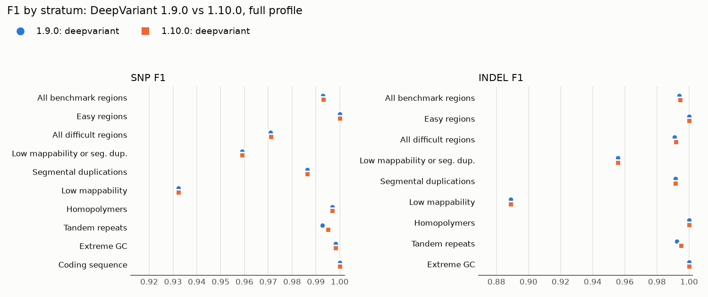

# Upgrade report: DeepVariant 1.9.0 → 1.10.0

| Field | Value |
|---|---|
| Date | 2026-10-23 |
| Component | DeepVariant (germline small variants, WGS model) |
| From → to | `google/deepvariant:1.9.0@sha256:07e95b34e40cc50074d23273d479934a27e80919ac75bd97bf39a731e3c2d6ad` → `google/deepvariant:1.10.0@sha256:962e5a83b1d76aae6990625d47102785f791603f2138aa1fa9aa4fb6a2eecbe6` |
| Decision | **Approve**, with a note to customers about two output changes |

## Summary and recommendation

Approve. On the 5 Mb `full` profile, 1.10.0 changed the benchmark decision at one locus, a
multiallelic insertion in a CA repeat, and got it right where 1.9.0 had it wrong. SNP false
positives fell from 20 to 19 and missed INDELs from 9 to 8. Every stratum is unchanged or slightly
better, and the regression gate passes with 0 of 25 rows failing.

Two changes in the VCF need a line in the release notes, because they can break a customer's
filtering or parsing even though accuracy did not get worse (see [Risks](#risks-and-follow-ups)):
records with no genotype are now filtered `NoCall` instead of `RefCall`, and every record now
carries the `MID` FORMAT field.

## What changed

From the [v1.10.0 release notes](https://github.com/google/deepvariant/releases/tag/v1.10.0)
(published 2026-03-05), the items that apply to short-read WGS germline calling:

> Implemented a new multiallelic variant post-processing method called “product” which is enabled
> for all modes except for WES.

> `run_deepvariant` and `run_deepsomatic` now reads parameters from `model.example_info.json` files

and, from the contributors section, work on "enhancing read sampling stability, fixing
non-determinism, and creating robust read sampling approach at high coverages".

The release notes do not mention retraining the short-read WGS model or changing any default
flag. The other headline items (continuous phasing, an ONT model, RNA-seq, DeepSomatic,
pangenome-aware reassembly) do not apply to this workflow. The multiallelic change is the one to
test, since it can change genotypes at sites with more than one alternate allele.

## Validation performed

- Profile `full`: HG002 35x NovaSeq, `chr20:21000001-26000000` (5 Mb), against GIAB v4.2.1 with
  the GIAB v3.6 stratifications listed in `config/strat_subset.tsv`; hap.py 0.3.15 with vcfeval.
- Both runs used the same inputs, 4 shards, 4 CPUs and 8 GiB; only the image differed. Preflight
  was off for both, since it does not affect calls.

```bash
make run PROFILE=full LABEL=full-deepvariant-1.9.0 EXTRA="run_preflight=false callers=deepvariant \
    deepvariant_docker=google/deepvariant:1.9.0@sha256:07e95b34e40cc50074d23273d479934a27e80919ac75bd97bf39a731e3c2d6ad"
make run PROFILE=full LABEL=full-deepvariant-1.10.0 EXTRA="run_preflight=false callers=deepvariant"
python3 scripts/compare_metrics.py docs/results/full-deepvariant-1.9.0/metrics.json \
    docs/results/full-deepvariant-1.10.0/metrics.json --thresholds config/thresholds.yaml \
    --out-md docs/results/full-deepvariant-1.10.0/upgrade-gate.md
python3 scripts/diff_decisions.py results/full-deepvariant-1.9.0/deepvariant.vcf.gz \
    results/full-deepvariant-1.10.0/deepvariant.vcf.gz -n 15
python3 scripts/plot_metrics.py --metrics 1.9.0=docs/results/full-deepvariant-1.9.0/metrics.json \
    --metrics 1.10.0=docs/results/full-deepvariant-1.10.0/metrics.json --out docs/results/figures \
    --prefix deepvariant-upgrade- --title "DeepVariant 1.9.0 vs 1.10.0, full profile"
```

## Results

Baseline = 1.9.0, candidate = 1.10.0:

--8<-- "results/full-deepvariant-1.10.0/upgrade-gate.md"



The only visible movement is in tandem repeats, for both SNPs and INDELs; the next section shows
that both come from the same site. The same data as a table:
[`deepvariant-upgrade-f1_by_stratum.md`](../results/figures/deepvariant-upgrade-f1_by_stratum.md);
recall and precision with intervals:
[`deepvariant-upgrade-recall_precision_by_stratum.png`](../results/figures/deepvariant-upgrade-recall_precision_by_stratum.png).

## Discordant calls examined

Output of `diff_decisions.py` on the two hap.py VCFs:

--8<-- "results/full-deepvariant-1.10.0/changed-sites.md"

The three rows are one locus, written in different allele combinations by the two versions.
The truth there is heterozygous for two insertions into a CA repeat: `+CA` and `+CACACACACACA`.
DeepVariant's own records (from `calls.vcf.gz`, before normalisation):

| Version | ALT | GT | QUAL | AD |
|---|---|---|---:|---|
| 1.9.0 | `ACA,GCA,GCACACACACACA` | 0/1 | 29.1 | 0,3,13,2 |
| 1.10.0 | `ACA,GCA,GCACACACACACA` | 2/3 | 98.8 | 0,3,13,2 |

Both versions saw the same three candidate alleles with the same read support. 1.9.0 called
reference plus `ACA` (a G>A change followed by a CA insertion, backed by 3 reads), which hap.py
scores as a false-positive SNP, a correct CA insertion and a missed 12 bp insertion. 1.10.0
genotyped the site as the two insertions, which matches the truth exactly, with much higher
confidence. This is what the new multiallelic post-processing is meant to do. It explains every
count that moved: one SNP false positive gone and one INDEL false negative gone, in every stratum
that contains the site (for example SNP `all`, `tandem_repeat`, `all_difficult`; INDEL `all`,
`tandem_repeat`, `all_difficult`, `TS_contained`, `not_lowmap_or_segdup`).

Outside the GIAB confident regions, where hap.py does not score calls, the normalised VCFs differ
at four more sites:

| Site | 1.9.0 | 1.10.0 | Note |
|---|---|---|---|
| chr20:21,787,363, two TA-repeat insertions | 0/1, QUAL 24.2 | 1/2, QUAL 46.6 | multiallelic, now het-alt |
| chr20:23,099,840, `GCACA` → `G`,`GCA` | **0/0 with FILTER PASS**, QUAL 24.8 | 1/2, QUAL 73.4 | multiallelic, now het-alt |
| chr20:23,099,844 A>G (inside the deletion above) | 1/1 PASS (small model) | 0/0 RefCall | GIAB v4.2.1 has 0/1 here, unscored |
| chr20:25,642,616 A>G | **0/0 with FILTER PASS** | 0/0 RefCall | label only |

The two **0/0 PASS** records are worth knowing about: 1.9.0 marked them as passing although the
genotype is homozygous reference, so a customer who counted variants by `FILTER == PASS` alone
would have counted them. 1.10.0 writes none. Out of 12,232 raw output records each (before
normalisation), 1.9.0 had 8,031 PASS
records with an ALT genotype plus those 2; 1.10.0 has 8,031.

## Runtime and cost impact

`DeepVariant` rows of `docs/results/<label>/resources.tsv` (one run each, same machine, run one
after the other):

| Version | Wall time (s) | CPU time (s) | Peak memory (bytes) |
|---|---:|---:|---:|
| 1.9.0 | 225.34 | 783.18 | 7,523,241,984 |
| 1.10.0 | 235.49 | 803.72 | 8,487,870,464 |

Wall time is 4.5% higher and CPU time 2.6% higher with 1.10.0, from one run each. That is within
what this laptop varies between repeats of the same run (69.5 s and 100.3 s for one configuration
in [CS-03](../case-studies/CS-03-deepvariant-memory.md)), so treat it as "no clear change" and
re-measure on cloud hardware. Peak memory is the cgroup's `memory.peak`, which counts page cache
and fills toward the 8 GiB limit; on the 200 kb `ci` region CS-03 measured a peak of about 2 GiB.
It is not a sign that 1.10.0 needs more memory, but it is not proof that it doesn't either. No
change to the cost estimate.

## Risks and follow-ups

- **Customer note: `NoCall` instead of `RefCall`.** 580 records with no genotype (`./.`) were
  filtered `RefCall` by 1.9.0 and are filtered `NoCall` by 1.10.0; they are the same 580 sites in
  both. The VCF header still describes `NoCall` as "Site has depth=0", but these records have reads
  (for example DP=9). PASS-only filtering is unaffected; a filter that drops `RefCall` to remove
  non-variant records will now let these through.
- **Customer note: `MID` on every record.** The FORMAT field that names the model that made the
  call (`deepvariant` or `small_model`) is now on all records; in 1.9.0 it was missing from 2,411
  of 12,232. Parsers that read FORMAT by position instead of by key will break. The small model
  made 38 fewer calls (9,821 to 9,783), handing them to the full model.
- **Not covered: exome.** The multiallelic change is off for WES by design. Validate the WES model
  separately before telling exome customers anything.
- **Not covered: GVCF output and joint calling.** This workflow writes VCF only.
- **Scale.** 5 Mb of one chromosome of one sample, with one confident-region site changed. The
  direction is good, but one site says nothing about the size of the gain genome-wide.
- After release, the weekly `full` CI run and `baselines/full.json` pick up the new numbers; the
  baseline update follows [the baseline runbook](../runbooks/updating-baselines.md).
