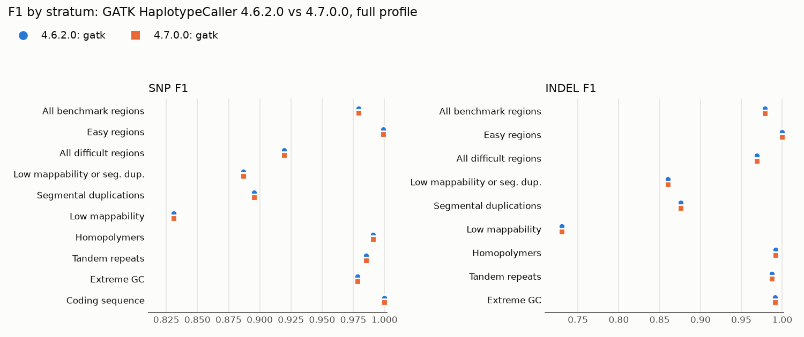

# Upgrade report: GATK 4.6.2.0 → 4.7.0.0

| Field | Value |
|---|---|
| Date | 2026-10-23 |
| Component | GATK HaplotypeCaller (germline small variants) |
| From → to | `broadinstitute/gatk:4.6.2.0@sha256:71b17ee42d149e8ec112603f5305c873ab60d93949ef8bb62a4fff85427f56fb` → `broadinstitute/gatk:4.7.0.0@sha256:7da5cf586e1c463f0c72908f9ac7dec8c29e37912c82d6e7b3c250f27fcb3891` |
| Decision | **Approve** |

## Summary and recommendation

Approve. On the 5 Mb `full` profile, variant calls produced by GATK 4.7.0.0 were identical
to those from 4.6.2.0. All 8,799 normalized VCF records were byte-for-byte identical, including
the INFO and genotype fields. No benchmark classification changed at any site, and F1 remained
unchanged in every stratum. There were 0 failing rows among 26 rows, and the regression gate
passed. Runtime differences were within the range of variation between runs.

## What changed

The following items listed in
[4.7.0.0 release notes](https://github.com/broadinstitute/gatk/releases/tag/4.7.0.0)
(published 2026-08-18) could affect germline variant calling using HaplotypeCaller:

> Upgraded to **HTSJDK 5.0.0** and **Picard 3.5.0**, bringing full CRAM 3.1 write support and
> faster BAM/CRAM I/O (#9406, #9216).

> Updated **GKL to 0.9.1**, including an optimized implementation of the DRAGEN PDHMM (#9152, #9220).

Under HaplotypeCaller:

> Added a command-line option to upweight ALT-supporting reads (#9234).

> New `--output-cram-version` option to select the CRAM version (3.0 or 3.1) for CRAM output;
> default is 3.1 (#9413).

The upgrade to the read-processing library (HTSJDK 5) affects all BAM reads and is therefore the
change most likely to have an effect. The option to increase ALT weighting is new and remains
disabled unless requested. This workflow does not use DRAGEN PDHMM. CRAM defaults only affect
tools which write CRAM, while this workflow does not write CRAM.

## Validation performed

- Profile `full` used HG002 35x NovaSeq data from `chr20:21000001-26000000` (5 Mb) and GIAB
  v3.6 stratifications listed in `config/strat_subset.tsv`. Comparison against GIAB v4.2.1 was
  performed using hap.py 0.3.15 with vcfeval.
- The same inputs, thread counts, and memory (4 CPU, 6 GiB) were used for both runs, and only the
  image differed. Since preflight does not affect variant calling results, it was disabled in both
  runs.

```bash
make run PROFILE=full LABEL=full-gatk-4.6.2.0 EXTRA="run_preflight=false callers=gatk \
    gatk_docker=broadinstitute/gatk:4.6.2.0@sha256:71b17ee42d149e8ec112603f5305c873ab60d93949ef8bb62a4fff85427f56fb"
make run PROFILE=full LABEL=full-gatk-4.7.0.0 EXTRA="run_preflight=false callers=gatk"
python3 scripts/compare_metrics.py docs/results/full-gatk-4.6.2.0/metrics.json \
    docs/results/full-gatk-4.7.0.0/metrics.json --thresholds config/thresholds.yaml \
    --out-md docs/results/full-gatk-4.7.0.0/upgrade-gate.md
python3 scripts/diff_decisions.py results/full-gatk-4.6.2.0/gatk.vcf.gz results/full-gatk-4.7.0.0/gatk.vcf.gz
python3 scripts/plot_metrics.py --metrics 4.6.2.0=docs/results/full-gatk-4.6.2.0/metrics.json \
    --metrics 4.7.0.0=docs/results/full-gatk-4.7.0.0/metrics.json --out docs/results/figures \
    --prefix gatk-upgrade- --title "GATK HaplotypeCaller 4.6.2.0 vs 4.7.0.0, full profile"
```

## Results

Baseline = 4.6.2.0, candidate = 4.7.0.0:

--8<-- "results/full-gatk-4.7.0.0/upgrade-gate.md"



The two series overlapped in every stratum. A tabular version of the same data is provided in
[`gatk-upgrade-f1_by_stratum.md`](../results/figures/gatk-upgrade-f1_by_stratum.md). Values for
recall and precision are shown with intervals in
[`gatk-upgrade-recall_precision_by_stratum.png`](../results/figures/gatk-upgrade-recall_precision_by_stratum.png).

## Discordant calls examined

Output after running `diff_decisions.py` on 2 hap.py VCF files:

--8<-- "results/full-gatk-4.7.0.0/changed-sites.md"

There was nothing to investigate. For a more stringent check, the normalized variant call VCFs
were compared record by record (`zcat … | grep -v '^#'`). All 8,799 records were identical, and
the QUAL, annotation, and genotype fields did not change.

## Runtime and cost impact

`HaplotypeCaller` rows in `docs/results/<label>/resources.tsv` (each was run once and executed
sequentially on the same machine):

| Version | Wall time (s) | CPU time (s) | Peak memory (bytes) |
|---|---:|---:|---:|
| 4.6.2.0 | 282.75 | 1053.44 | 1,576,427,520 |
| 4.7.0.0 | 288.09 | 1072.01 | 1,448,022,016 |

CPU time increased by 1.8% in 4.7.0.0. Only 1 run was performed for each version, so such a small
change cannot be distinguished from noise. While other containers were running on the same laptop,
one DeepVariant configuration took 69.5 s in one run and 100.3 s in another
([CS-03](../case-studies/CS-03-deepvariant-memory.md)). Peak memory was the task cgroup's
`memory.peak` which also includes the page cache. However, it remained well below the requested 6
GiB. There was no change to the cost estimate.

## Risks and follow-ups

- **Not covered: GVCF mode.** This workflow calls variants in VCF mode. Customers who perform
  joint genotyping run HaplotypeCaller with `-ERC GVCF`. Validate this execution path (and
  GenotypeGVCFs) before telling customers that nothing will change after the upgrade.
- **Not covered: CRAM input.** CRAM reading and writing have changed in HTSJDK 5. BAM is used
  as input here. Before releasing to customers who submit CRAM, run 1 sample using CRAM as
  input.
- **Scale.** A 5 Mb region of one chromosome from one sample. Identical outputs here make
  genome-wide differences unlikely, though still possible.
- After release, monitor weekly `full` CI runs for changes relative to `baselines/full.json`.
