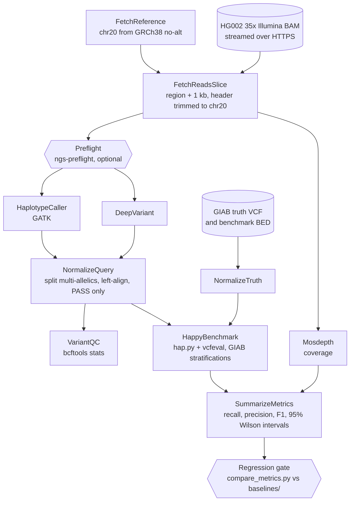

# How it works

This workflow (`wdl/main.wdl`, WDL 1.0) takes a region of chromosome 20 as input and calls variants
within it using one or two variant callers. These calls are evaluated against the Genome in a
Bottle (GIAB) truth set for HG002. It is run using miniwdl locally and in CI, while cloud runs use
Cromwell or AWS HealthOmics.

Each variant caller runs as 1 shard in a scatter. Therefore, benchmarking and QC each run
1 time per caller. All tasks output `resources.json` (elapsed time, CPU time, peak
memory usage, requested CPU count, and requested memory capacity). `scripts/collect_run.py`
aggregates this information into `resources.tsv`, and `scripts/estimate_cost.py` calculates
costs.

## Profiles

| Profile | Region | Used for |
|---|---|---|
| `fixture` | `chr20:21860001-21890000` (30 kb) | Unit and integration tests |
| `ci` | `chr20:21800001-22000000` (200 kb) | Every push, with the regression gate |
| `full` | `chr20:21000001-26000000` (5 Mb) | Caller comparison, upgrade reports, weekly CI |

`scripts/fetch_data.py pick-region` selected the `ci` window. This script scans the chr20
benchmark VCF and the BED for difficult regions to find a window with enough
variants and some difficult sequence.

## Data sources

| Data | Source |
|---|---|
| Reads | HG002 NovaSeq PCR-free 35x, aligned to GRCh38 no-alt (Google DeepVariant case-study data) |
| Reference | `GCA_000001405.15_GRCh38_no_alt_analysis_set` |
| Truth (default) | GIAB HG002 v4.2.1, GRCh38, benchmark VCF and `noinconsistent` BED |
| Truth (comparison only) | GIAB HG002 v5.0q small variants. A **draft** benchmark; never used as the release gate |
| Strata | GIAB genome stratifications v3.6 (GRCh38) |
| Trio (deliverables) | GIAB HG003 and HG004 v4.2.1 benchmark VCFs |

Exact URLs and MD5 checksums are listed in `config/data_manifest.tsv`. `fetch_data.py`
verifies every download against them.

GIAB data are released by NIST for benchmarking. Please cite:

- Zook JM et al. Extensive sequencing of seven human genomes to characterize benchmark reference
  materials. *Sci Data* 3, 160025 (2016).
  [doi:10.1038/sdata.2016.25](https://doi.org/10.1038/sdata.2016.25)
- Wagner J et al. Benchmarking challenging small variants with linked and long reads.
  *Cell Genomics* 2(5), 100128 (2022). [doi:10.1016/j.xgen.2022.100128](https://doi.org/10.1016/j.xgen.2022.100128)
- Dwarshuis N et al. The GIAB genomic stratifications resource for human reference genomes.
  *Nat Commun* 15, 9029 (2024). [doi:10.1038/s41467-024-53260-y](https://doi.org/10.1038/s41467-024-53260-y)
- Krusche P et al. Best practices for benchmarking germline small-variant calls in human genomes.
  *Nat Biotechnol* 37, 555–560 (2019). [doi:10.1038/s41587-019-0054-x](https://doi.org/10.1038/s41587-019-0054-x)

## Design choices worth knowing

- **The read header is trimmed to chr20.** This workflow uses a reference sequence containing
  only chr20. The slice is re-headered so other tools and `ngs-preflight` see
  matching contigs. GATK 4.7 and DeepVariant 1.10 would accept additional contigs
  ([CS-02](case-studies/CS-02-contig-names.md)), while other tools do not.
- **Memory limits are hard.** `config/miniwdl.cfg` enforces `runtime.memory` in the same way as
  a cloud VM. Therefore, a task which would be forcibly terminated in the cloud would also be
  forcibly terminated locally ([CS-03](case-studies/CS-03-deepvariant-memory.md)).
- **Parameters count as versions.** Parameters which affect variant-calling results
  (`gatk_extra_args`, `extra_norm_args`) are recorded alongside the image digests in
  `metrics.json`. This means the regression gate can distinguish parameter changes from
  nondeterminism ([INC-01](incidents/INC-01-mapq-default-change.md)).
- **An empty benchmark fails the run.** hap.py accepts a result as valid when there are no truth
  variants in the regions. So `SummarizeMetrics` stops the run instead
  ([CS-02](case-studies/CS-02-contig-names.md)).
